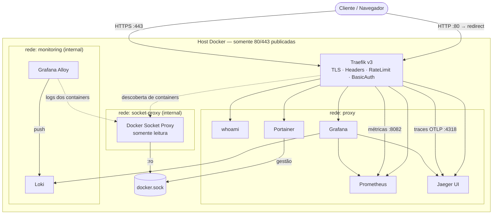

# 🛡️ Lab Stack Traefik

**Reverse proxy seguro com Traefik v3 e observabilidade completa (métricas, logs e traces) em Docker Compose.**


Laboratório construído de forma incremental para aplicar, na prática, as boas práticas de publicação de aplicações atrás do Traefik: **somente as portas 80/443 expostas**, TLS endurecido, middlewares de segurança, acesso à API do Docker via Socket Proxy e uma stack de observabilidade integrada no Grafana.

> 📘 A trilha completa de construção, etapa por etapa, está em [`docs/etapas.md`](docs/etapas.md).

---

## 📑 Sumário

- [Arquitetura](#-arquitetura)
- [Tecnologias](#-tecnologias)
- [Features](#-features)
- [Estrutura do projeto](#-estrutura-do-projeto)
- [Pré-requisitos](#-pré-requisitos)
- [Como usar](#-como-usar)
- [Validação](#-validação)
- [Publicando uma nova aplicação](#-publicando-uma-nova-aplicação)
- [Dashboard de observabilidade](#-dashboard-de-observabilidade)
- [Comandos úteis](#-comandos-úteis)
- [Troubleshooting](#-troubleshooting)
- [Roadmap](#-roadmap)

---

## 🏗️ Arquitetura



### Fluxo de cada requisição

```
Cliente → Traefik :443 → TLS (tls-hardening) → Router (Host rule)
        → Middlewares [security-headers → rate-limit → basic-auth] → Serviço (rede proxy)
```

### Fluxo de telemetria

| Sinal | Caminho |
|-------|---------|
| **Métricas** | Traefik `:8082/metrics` → Prometheus → Grafana |
| **Logs** | Docker → Socket Proxy → Alloy → Loki → Grafana |
| **Traces** | Traefik → OpenTelemetry (OTLP/HTTP) → Jaeger → Grafana |

---

## 🧰 Tecnologias

| Tecnologia | Versão | Papel no projeto |
|------------|--------|------------------|
| [Docker](https://docs.docker.com/) / Compose v2 | — | Orquestração dos containers |
| [Traefik](https://doc.traefik.io/traefik/) | v3.7 | Reverse proxy, TLS, middlewares, métricas e tracing |
| [Docker Socket Proxy](https://github.com/Tecnativa/docker-socket-proxy) | latest | Filtro de acesso somente leitura à API do Docker |
| [Portainer CE](https://docs.portainer.io/) | LTS | Gestão do Docker Engine via interface web |
| [traefik/whoami](https://github.com/traefik/whoami) | latest | Aplicação de teste de roteamento |
| [Prometheus](https://prometheus.io/) | v3 | Coleta e armazenamento de métricas |
| [Grafana Loki](https://grafana.com/oss/loki/) | 3.x | Armazenamento e consulta de logs |
| [Grafana Alloy](https://grafana.com/oss/alloy/) | 1.x | Coletor de logs dos containers |
| [Jaeger](https://www.jaegertracing.io/) | v2 | Tracing distribuído (recebe OTLP) |
| [OpenTelemetry](https://opentelemetry.io/) | OTLP/HTTP | Protocolo de exportação de traces do Traefik |
| [Grafana](https://grafana.com/) | 13 | Dashboards unificados de métricas, logs e traces |
| OpenSSL | — | CA local e certificados com SAN |

---

## ✨ Features

### 🔐 Segurança e boas práticas com Traefik

- **Superfície mínima de exposição** — apenas o Traefik publica portas (80/443). Portainer, Grafana, Prometheus, Jaeger, Loki e Whoami **não têm `ports:`**.
- **`exposedByDefault=false`** — nenhum container é publicado sem `traefik.enable=true` explícito.
- **Docker Socket Proxy** — o Traefik **não monta o `docker.sock`**; consulta a API via `tcp://socket-proxy:2375` com permissões mínimas (`CONTAINERS`, `EVENTS`, `PING`, `VERSION`) e `POST=0`.
- **Redes segmentadas** — `proxy` (tráfego HTTP), `socket-proxy` e `monitoring` marcadas como `internal` (sem saída para a internet).
- **Dashboard seguro** — `api.insecure=false`, sem porta 8080; publicado via router para `api@internal`, restrito a `/api` e `/dashboard`.
- **BasicAuth** com hash **bcrypt** em arquivo (`usersfile`), fora do Git e sem o problema de escape `$$`.
- **HTTPS em tudo** — redirect permanente HTTP → HTTPS no entrypoint.
- **TLS Hardening** — TLS ≥ 1.2, somente cipher suites AEAD com Forward Secrecy, curvas modernas e `sniStrict`.
- **CA local** — certificado wildcard `*.domain.local` com SANs explícitos, renovável sem trocar a CA.
- **Security Headers** — HSTS (1 ano), `X-Content-Type-Options: nosniff`, `X-Frame-Options: DENY`, `Referrer-Policy`, `Permissions-Policy` e `Content-Security-Policy`.
- **Rate Limiting por aplicação** — políticas independentes (token bucket) para dashboard, whoami e Portainer; excesso retorna **HTTP 429**.
- **`no-new-privileges`** em todos os containers.
- **Segredos fora do repositório** — `.env`, `htpasswd`, chaves e certificados no `.gitignore`.
- **Healthcheck** do Traefik via `/ping`.

### 📊 Observabilidade

- **Métricas** do Traefik por entrypoint, router e serviço, coletadas por um entrypoint interno não publicado.
- **Access log em JSON** — consultável no Loki com `| json`.
- **Logs de todos os containers** descobertos automaticamente pelo Alloy, com labels `platform="docker"` e `service_name`.
- **Tracing distribuído** — cada requisição do Traefik gera um trace no Jaeger via OpenTelemetry.
- **Grafana provisionado como código** — data sources e dashboards carregados automaticamente na subida.
- **Correlação logs → traces** — campo derivado no Loki transforma `TraceId` em link para o Jaeger.
- **Dashboard v3** — status dos serviços, requisições, taxa de erro, latência p50/p95/p99, logs e traces em um único painel.

---

## 📁 Estrutura do projeto

```
lab-stack-traefik/
├── docker-compose.yml            # Stack completa
├── .env.example                  # Variáveis (copiar para .env)
├── Makefile                      # Atalhos: make up, make certs, make test...
├── traefik/
│   ├── dynamic/
│   │   └── tls.yml               # Certificados + opções TLS (file provider)
│   └── auth/
│       └── htpasswd              # Gerado por make htpasswd (ignorado no Git)
├── certs/                        # CA e certificados (gerados, ignorados no Git)
├── prometheus/
│   └── prometheus.yml            # Alvos de scrape
├── loki/
│   └── loki-config.yml           # Loki monolítico (TSDB + filesystem + retenção)
├── alloy/
│   └── config.alloy              # Docker (via socket-proxy) → Loki
├── grafana/
│   ├── provisioning/
│   │   ├── datasources/datasources.yml
│   │   └── dashboards/dashboards.yml
│   └── dashboards/
│       └── docker-observability-v3.json
├── scripts/
│   ├── gen-certs.sh              # CA local + certificado wildcard com SANs
│   ├── gen-htpasswd.sh           # Usuário/senha do BasicAuth (bcrypt)
│   ├── hosts.sh                  # Entradas para /etc/hosts
│   └── smoke-test.sh             # Testes de redirect, auth, headers e TLS
└── docs/
    ├── etapas.md                 # Construção incremental do laboratório
    ├── troubleshooting.md        # Problemas reais e soluções
    └── images/                   # Diagramas e screenshots
```

---

## ✅ Pré-requisitos

- Linux com **Docker Engine** e **Docker Compose v2** (o laboratório original rodou em uma VM Ubuntu via Vagrant, IP `192.168.56.6`)
- `openssl`, `curl` e `make`
- `htpasswd` (pacote `apache2-utils` / `httpd-tools`) — opcional, o script usa um container se não houver
- Portas **80** e **443** livres no host

---

## 🚀 Como usar

### 1. Clonar e configurar

```bash
git clone https://github.com/joaoplsaraiva/lab-stack-traefik.git
cd lab-stack-traefik

make init          # cria .env a partir do .env.example (chmod 600)
nano .env          # ajuste DOMAIN, HOST_IP e GRAFANA_ADMIN_PASSWORD
```

### 2. Gerar certificados (CA local)

```bash
make certs
```

Depois, faça o cliente confiar na CA:

```bash
# Ubuntu / Debian
sudo cp certs/ca.crt /usr/local/share/ca-certificates/laboratorio-root-ca.crt
sudo update-ca-certificates

# Fedora / RHEL
sudo cp certs/ca.crt /etc/pki/ca-trust/source/anchors/laboratorio-root-ca.crt
sudo update-ca-trust
```

No navegador, importe `certs/ca.crt` como **Autoridade Certificadora**.

### 3. Criar o usuário do BasicAuth

```bash
make htpasswd      # pede a senha e gera traefik/auth/htpasswd
```

### 4. Configurar o DNS local

Na máquina de onde você acessa o navegador:

```bash
./scripts/hosts.sh | sudo tee -a /etc/hosts
```

### 5. Subir a stack

```bash
make up            # valida com `docker compose config` e sobe
make ps
```

### 6. Acessar

| Serviço | URL | Autenticação |
|---------|-----|--------------|
| Whoami | `https://whoami.domain.local` | — |
| Portainer | `https://portainer.domain.local` | Usuário criado no 1º acesso |
| Traefik Dashboard | `https://traefik.domain.local/dashboard/` | BasicAuth |
| Grafana | `https://grafana.domain.local` | BasicAuth + login Grafana |
| Prometheus | `https://prometheus.domain.local` | BasicAuth |
| Jaeger | `https://jaeger.domain.local` | BasicAuth |

> ⚠️ **Portainer:** crie o usuário administrador logo após a primeira subida — por segurança, o Portainer desativa a tela de setup inicial após alguns minutos.

---

## 🧪 Validação

```bash
make test
```

O `smoke-test.sh` verifica:

- redirect HTTP → HTTPS (301/308);
- rotas públicas respondendo 200;
- rotas protegidas respondendo **401** sem credencial;
- presença de todos os security headers;
- recusa de **TLS 1.1**;
- que nenhum container além do Traefik publica portas.

Testes manuais úteis:

```bash
# Rate limit: devem aparecer respostas 429
for i in {1..100}; do
  curl -s -o /dev/null -w "Request $i -> HTTP %{http_code}\n" https://whoami.domain.local
done

# Certificado servido
openssl s_client -connect grafana.domain.local:443 -servername grafana.domain.local </dev/null 2>/dev/null \
  | openssl x509 -noout -subject -issuer -dates -ext subjectAltName

# O Traefik não deve ter o docker.sock montado
docker inspect traefik --format '{{range .Mounts}}{{println .Source " -> " .Destination}}{{end}}'

# Prometheus pronto
curl -u admin https://prometheus.domain.local/-/ready
```

---

## ➕ Publicando uma nova aplicação

Basta conectar o container à rede `proxy` e declarar as labels — sem `ports:`:

```yaml
  minha-app:
    image: nginx:alpine
    restart: unless-stopped
    security_opt:
      - no-new-privileges:true
    networks:
      - proxy
    labels:
      - "traefik.enable=true"
      - "traefik.docker.network=proxy"
      - "traefik.http.routers.minha-app.rule=Host(`app.${DOMAIN}`)"
      - "traefik.http.routers.minha-app.entrypoints=websecure"
      - "traefik.http.routers.minha-app.tls=true"
      - "traefik.http.routers.minha-app.tls.options=tls-hardening@file"
      - "traefik.http.routers.minha-app.middlewares=security-headers@docker"
      - "traefik.http.services.minha-app.loadbalancer.server.port=80"
```

Checklist:

1. Adicione `app` em `SERVICES` no `scripts/gen-certs.sh` e rode `make certs` (ou confie no wildcard `*.domain.local`).
2. `docker compose restart traefik`.
3. Adicione `app.domain.local` ao `/etc/hosts`.
4. Se necessário, crie um rate limit próprio (`minha-app-ratelimit`) nas labels do Traefik.

A aplicação passa a ter automaticamente métricas no Prometheus, logs no Loki e traces no Jaeger.

---

## 📈 Dashboard de observabilidade

O dashboard **Docker Observability v3** é carregado automaticamente na pasta *Lab Stack Traefik* do Grafana:

| Seção | Conteúdo |
|-------|----------|
| Visão geral | Alvos UP, requisições/s, taxa de erro 5xx, latência p95, status de cada serviço |
| Tráfego HTTP | Requisições por serviço, por código HTTP, latência p50/p95/p99, erros 4xx/5xx (inclui 429 do rate limit) |
| Logs | Volume de logs por container e visualização com filtro por container e texto livre |
| Traces | Últimos traces do Traefik no Jaeger, com link para o trace completo |

Consultas LogQL úteis no Explore:

```logql
{platform="docker", service_name="traefik"} | json | DownstreamStatus >= 500
sum by (service_name) (count_over_time({platform="docker"} [5m]))
```

<!-- Adicione aqui os screenshots em docs/images/ -->
<!--  -->

---

## 🛠️ Comandos úteis

```bash
make help              # lista os atalhos
make config            # valida o compose
make logs s=traefik    # logs de um serviço
make down              # derruba (mantém volumes)
docker compose up -d traefik   # recria só o Traefik
```

---

## 🩺 Troubleshooting

Os problemas reais encontrados durante o laboratório (resolução de nome x CA, SAN de certificado, escape `$$` no BasicAuth, `405` no endpoint OTLP, Loki com ingester em *shutting down* por falta de disco) estão documentados em [`docs/troubleshooting.md`](docs/troubleshooting.md).

---

## 🗺️ Roadmap

- [x] Traefik com Docker provider e `exposedByDefault=false`
- [x] Dashboard seguro com BasicAuth
- [x] Security headers, HSTS e rate limit
- [x] HTTPS com CA local e TLS hardening
- [x] Docker Socket Proxy para o Traefik
- [x] Métricas, logs e traces integrados no Grafana
- [ ] Let's Encrypt (DNS Challenge para ambiente interno)
- [ ] Portainer Agent / Socket Proxy para o Portainer
- [ ] Alertas (Grafana Alerting / Alertmanager)
- [ ] Separação de ambientes DEV / HML / PRD

---

## ⚠️ Aviso

Este é um **ambiente de laboratório**. Antes de usar em produção, revise senhas, certificados (prefira Let's Encrypt ou a PKI institucional), retenção de dados, backups dos volumes e o acesso RW do Portainer ao Docker Engine.

## 📚 Referências

- [Traefik — Docker provider](https://doc.traefik.io/traefik/reference/install-configuration/providers/docker/)
- [Traefik — API & Dashboard](https://doc.traefik.io/traefik/reference/install-configuration/api-dashboard/)
- [Portainer — Traefik reverse proxy](https://docs.portainer.io/advanced/reverse-proxy/traefik)
- [A complete guide to secure Docker Compose applications with Traefik](https://rragesh.medium.com/a-complete-guide-to-secure-docker-compose-applications-with-traefik-bde8b143839d)
- [Tecnativa Docker Socket Proxy](https://github.com/Tecnativa/docker-socket-proxy)

## 👤 Autor

**João Paulo Lima Saraiva** — Senior Network Analyst / DevOps Engineer

[](https://linkedin.com/in/joao-saraiva-41799428)
[](https://github.com/joaoplsaraiva)
[](https://credly.com/users/joao-paulo-lima-saraiva)

## 📄 Licença

Distribuído sob a licença MIT. Veja [`LICENSE`](LICENSE).
